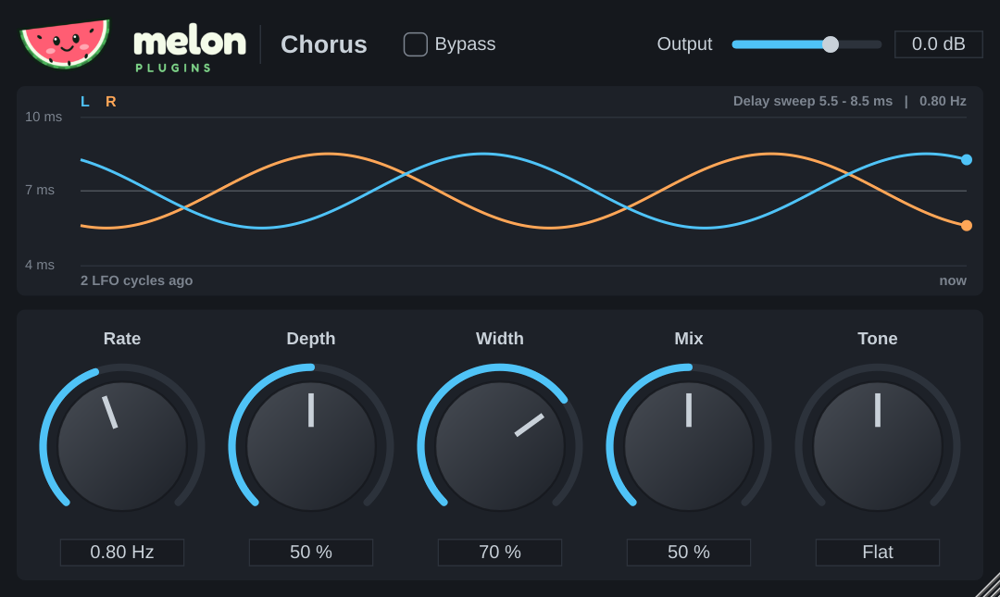

# Melon Chorus — VST3 / LV2 guitar chorus

A stereo chorus for guitar with the five controls you find on a chorus pedal, built with [JUCE](https://juce.com).
The same code produces **VST3** (Windows, Linux and Mac), **LV2** (Linux) and a **Standalone** app.



## Controls

| Knob | Range | Default | What it does |
|---|---|---|---|
| **Rate** | 0.10 – 8.00 Hz | 0.80 Hz | Speed of the chorus sweep. Slow settings shimmer; fast settings turn into vibrato-like warble. |
| **Depth** | 0 – 100 % | 50 % | How far the delay sweeps (up to ±3 ms around 7 ms), so how much the pitch wobbles. |
| **Width** | 0 – 100 % | 70 % | Stereo spread. At 0 % both sides sweep together (mono chorus); at 100 % left and right sweep in opposite directions. |
| **Mix** | 0 – 100 % | 50 % | Dry/wet balance. At 50 % the dry guitar and the chorus are both at full level, the classic pedal sound. Above 50 % the dry signal fades out; at 100 % you hear only the chorus (pure vibrato). |
| **Tone** | Dark 100 – Flat – Bright 100 | Flat | Tone of the chorus signal: turns its highs down (up to −10 dB, warmer, more "analog") or up (up to +10 dB, more sparkle). The lows and the dry guitar are left alone. |

The header has the series' standard **Bypass** (linked to the host's bypass, with a short crossfade so it doesn't click) and **Output** gain (−24 to +12 dB).
Double-click a knob to reset it. The display shows the delay sweep of the left (blue) and right (orange) channels over the last two LFO cycles.

## Using it with a guitar

- Put it on a **stereo** track. A mono guitar input works: the plugin accepts mono in / stereo out and Width spreads the chorus across both speakers. On a mono track the plugin runs in mono and Width has no effect.
- Place it after the amp or amp-sim for the classic "chorus in the effects loop" sound, or before a clean amp-sim like a pedal.
- With Mix at 50 %, peaks can be up to 6 dB louder than the dry guitar. Lower **Output** if the next plugin clips.

Starting points:

| Sound | Rate | Depth | Width | Mix | Tone |
|---|---|---|---|---|---|
| Subtle clean shimmer | 0.6 Hz | 30 % | 80 % | 40 % | Flat |
| 80s clean chorus | 1.0 Hz | 60 % | 100 % | 50 % | Bright 20 |
| Warm, analog-style | 0.5 Hz | 50 % | 60 % | 50 % | Dark 50 |
| Vibrato | 5.0 Hz | 35 % | 0 % | 100 % | Flat |

## How it works

Each channel feeds a short delay line whose delay time is swept by a sine LFO (7 ms ± up to 3 ms). The moving delay detunes the copy slightly; mixing it with the dry signal gives the chorus. The right channel's LFO is offset by up to 180° (Width). The delayed signal is read with 4-point Hermite interpolation and then goes through a first-order high shelf at 1.5 kHz (Tone). Every parameter is smoothed, so turning knobs never makes zipper noise or clicks.

## Building

This plugin is part of **Melon Plugins**. Full build instructions are in the `README.md` at the root of the series (`E:\melon_plugins`).

To build only this plugin, from the series root:

```powershell
cmake -B build -A x64
cmake --build build --config Release --target Chorus_VST3
```

The plugin ends up in `build\plugins\Chorus\Chorus_artefacts\Release\VST3\Melon Chorus.vst3`.

## Structure

| File | What it does |
|---|---|
| `Source/ChorusDsp.h` | Plain C++ DSP core: delay line, LFO, Tone shelf and processing engine. |
| `Source/PluginProcessor.*` | Parameters, state and audio processing (JUCE). |
| `Source/PluginEditor.*` | User interface: knobs, sweep display and header. |
| `tests/test_dsp.cpp` | DSP test. Run it with `cmake --build build --target Chorus_test_dsp`. |

The tuning constants (base delay, sweep range, Rate limits, Tone frequency and range) are at the top of `Source/ChorusDsp.h`.

## Identification

| Item | Value |
|---|---|
| Name | Melon Chorus |
| Plugin code | `Chr1` |
| Manufacturer | Melon (`Meln`, defined in `cmake/MelonCommon.cmake`) |
| LV2 URI | `https://github.com/melon-audio/melon-chorus` |

## JUCE license

JUCE 8 is free under the **AGPLv3** license. If you distribute the plugin, its source code must also be released under AGPLv3. The alternative is a commercial JUCE license (see the options at juce.com). There are no restrictions for personal use.
