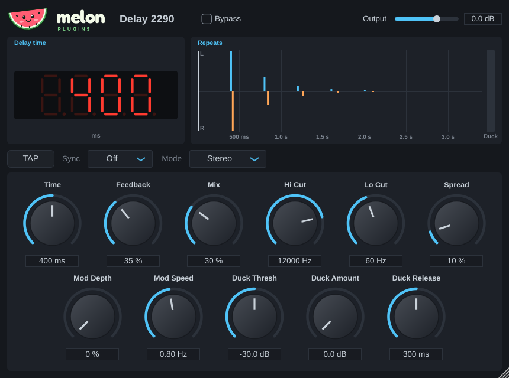

# Melon Delay 2290 — VST3 / LV2 digital delay

A clean stereo digital delay in the spirit of the **TC Electronic 2290** rack unit: long delays, tap tempo and host sync, filters in the feedback loop, delay modulation, three stereo modes and the 2290's famous **dynamic delay** (the repeats duck while you play and swell back when you stop). Built with [JUCE](https://juce.com).
The same code produces **VST3** (Windows, Linux and Mac), **LV2** (Linux) and a **Standalone** app.



## Controls

| Control | Range | Default | What it does |
|---|---|---|---|
| **TAP** | button | — | Click 2 or more times in rhythm: sets Time (average of the last taps) and turns Sync off. |
| **Sync** | Off, 1/1 … 1/16 T | Off | Locks the delay to the host tempo (straight, dotted and triplet values). Time is ignored while Sync is on. |
| **Mode** | Mono / Stereo / Ping-pong | Stereo | **Mono:** one delay on both sides. **Stereo:** left and right delays, the right one longer by Spread. **Ping-pong:** repeats bounce left → right → left. |
| **Time** | 1 – 5000 ms | 400 ms | Delay time. Changing it glides smoothly (no clicks). |
| **Feedback** | 0 – 100 % | 35 % | Number of repeats. Each repeat is Feedback × the previous one; 100 % = (almost) endless, safely limited. |
| **Mix** | 0 – 100 % | 30 % | Dry/delay balance. 50 % = both at full level; above 50 % the dry fades out. |
| **Hi Cut** | 1 – 20 kHz | 12 kHz | Low-pass on the repeats, inside the feedback loop: each repeat gets darker. |
| **Lo Cut** | 10 – 1000 Hz | 60 Hz | High-pass on the repeats, inside the feedback loop: each repeat gets thinner. |
| **Spread** | 0 – 100 % | 10 % | Stereo mode: the right delay is up to 50 % longer, for width. |
| **Mod Depth** | 0 – 100 % | 0 % | Modulation of the delay time (up to ±4 ms): subtle chorus to deep warble. |
| **Mod Speed** | 0.05 – 10 Hz | 0.8 Hz | Speed of the modulation (left and right 90° apart). |
| **Duck Thresh** | −60 – 0 dB | −30 dB | Dynamic delay: input level above which the repeats are turned down. |
| **Duck Amount** | 0 – 40 dB | 0 dB (off) | Dynamic delay: how much the repeats are turned down while you play. |
| **Duck Release** | 20 – 2000 ms | 300 ms | Dynamic delay: how fast the repeats come back when you stop. |

The header has the series' standard **Bypass** and **Output** gain.

The display has a **red LED readout** of the delay time (with the host tempo and sync value), the **pattern of repeats** over time (left repeats up, right repeats down) and a **Duck** meter showing how much the repeats are being turned down right now.

## Starting points

| Sound | Time | Feedback | Mix | Other |
|---|---|---|---|---|
| Classic 80s lead | 1/8 D (sync) | 35 % | 30 % | Mode Stereo, Mod Depth 15 %, Duck Amount 12 dB |
| Slapback | 110 ms | 0 % | 35 % | Mode Mono, Hi Cut 6 kHz |
| Wide ambient | 1/4 (sync) | 55 % | 35 % | Mode Ping-pong, Hi Cut 4 kHz, Lo Cut 200 Hz |
| Dub-style runaway | 380 ms | 95 % | 40 % | Hi Cut 2.5 kHz, turn Time while it repeats |

## How it works

Each side has a delay line read with 4-point Hermite interpolation (so modulation and time changes stay smooth). The repeats go through a high-pass (Lo Cut) and low-pass (Hi Cut) **inside the feedback loop**, then back into the delay through a soft safety limiter that is transparent at normal levels. The dynamic delay follows the input with a peak envelope (fast attack, Release-controlled decay) and turns down only the delayed signal, with a 6 dB soft knee around the threshold. Host sync reads the tempo from the DAW's transport.

## Test

```bash
g++ -std=c++17 -O2 -ISource -I../../shared tests/test_dsp.cpp -o test_dsp && ./test_dsp
```
