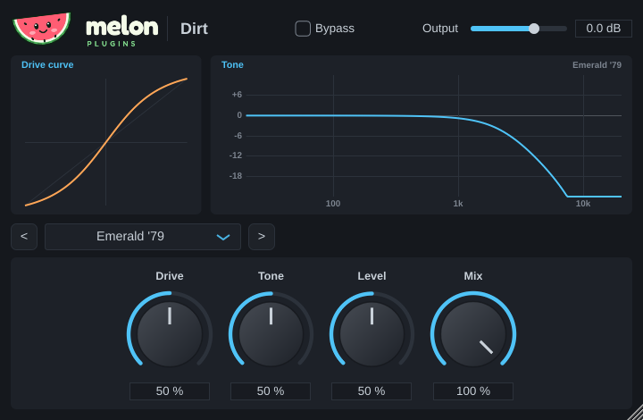

# Melon Dirt — VST3 / LV2 overdrive

Eleven classic overdrive voicings in one plugin, switched with a drop-down (or the **<** / **>** buttons). Each model is inspired by a well-known pedal but has its own name. Built with [JUCE](https://juce.com).
The same code produces **VST3** (Windows, Linux and Mac), **LV2** (Linux) and a **Standalone** app.



## Models

| Model | Inspired by | Character |
|---|---|---|
| **Emerald '79** | Ibanez TS808 | Mid hump, bass stays clean, smooth symmetric clipping |
| **Emerald Nine** | Ibanez TS9 | Same family, a little brighter and thinner |
| **Yellow Sun** | Boss SD-1 | Asymmetric clipping, a touch more gain and grit |
| **Plexi Grump** | JHS Angry Charlie | "Marshall in a box": two cascaded stages, tight bass, big upper mids |
| **Gutter Rodent** | ProCo RAT | Lots of gain, hard clipping, sweepable filter |
| **Hot Rod Brown** | Friedman BE-OD | High-gain amp-style drive, very tight low end |
| **Gilded Horse** | Klon Centaur | Transparent: clean blend that fades as Drive goes up, soft clipping, active treble |
| **Dawn Flower** | JHS Morning Glory | Bluesbreaker-style low-gain, open and flat |
| **Delta Blues** | Boss BD-1 | Amp-like, slightly asymmetric breakup |
| **Obsession** | Fulltone OCD | MOSFET-style asymmetric clipping, aggressive and open |
| **Studio Green** | Nobels ODR-1 | Natural mid-gain drive with a bass/treble "spectrum" tone |

All models are level-matched: at Drive 50 % and Level 50 % they are about as loud as each other, so you can compare them fairly.

## Controls

| Control | Range | Default | What it does |
|---|---|---|---|
| **Model** | 11 models | Emerald '79 | Drop-down, plus arrows to step through the models. Switching crossfades, so it never clicks. |
| **Drive** | 0 – 100 % | 50 % | Amount of overdrive. Each model has its own gain range. |
| **Tone** | 0 – 100 % | 50 % | Brightness. On the TS/SD/RAT/OCD models it sweeps a treble cut; on the others it tilts bass against treble. |
| **Level** | 0 – 100 % | 50 % | Output of the pedal. 50 % ≈ unity, 100 % = +12 dB. |
| **Mix** | 0 – 100 % | 100 % | Dry/overdriven blend. 100 % = like the pedal. |

The header has the series' standard **Bypass** and **Output** gain. Double-click a knob to reset it; hover for a short description.

The display shows the **drive curve** of the selected model at the current Drive (how the input level maps to the output level — a straight line is clean, an S-curve is clipping) and the **frequency response of the Tone** control.

## How it works

Every model is a set of numbers run through the same signal flow: an input high-pass (how much bass reaches the clipper), a mid "hump" filter, the gain stage(s), a clipping curve (soft, asymmetric, hard diode, LED, germanium or MOSFET style), an optional clean blend, the tone control and a fixed output filter. The clipping runs at **4× the sample rate** (6th-order anti-aliasing filters), so high Drive settings stay clean of aliasing. Parameters are smoothed, and switching models fades out, swaps and fades back in over a few milliseconds.

These are not circuit simulations: they reproduce the voicing of each pedal family.

## Test

```bash
g++ -std=c++17 -O2 -ISource -I../../shared tests/test_dsp.cpp -o test_dsp && ./test_dsp
```
