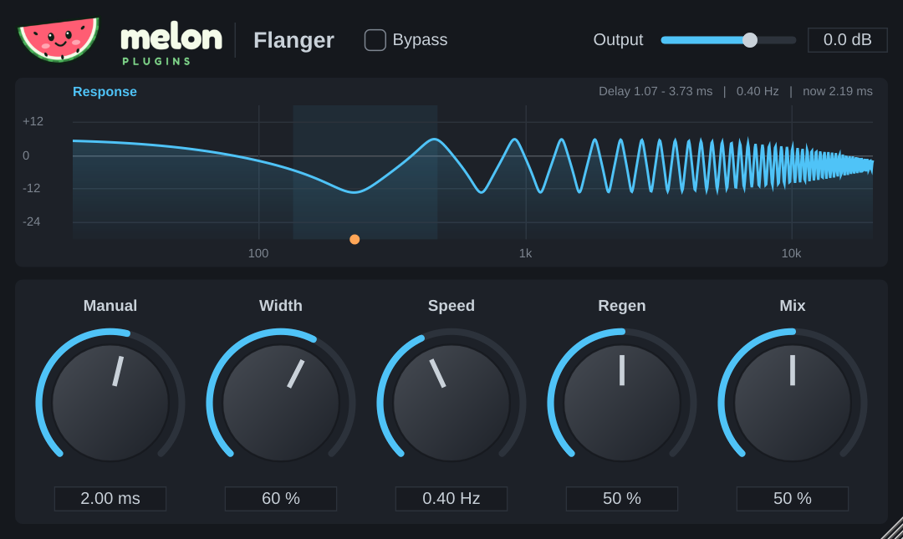

# Melon Flanger — VST3 / LV2 flanger

A flanger with the four controls of the classic MXR M117R pedal (**Manual, Width, Speed, Regen**), plus a **Mix** control. Built with [JUCE](https://juce.com).
The same code produces **VST3** (Windows, Linux and Mac), **LV2** (Linux) and a **Standalone** app.



Demo: [`docs/melon-flanger-demo.wav`](docs/melon-flanger-demo.wav) — the same strummed guitar three times: dry, default settings, then a slow, high-Regen "jet" flange.

## Controls

| Knob | Range | Default | What it does |
|---|---|---|---|
| **Manual** | 0.25 – 10 ms | 2.00 ms | Centre of the sweep (the delay time). Short delays put the notches high up (airy, metallic); long delays bring them down (hollow, phaser-like). With Width at 0 it sets a fixed, "frozen" flange — the pedal's classic manual trick. |
| **Width** | 0 – 100 % | 60 % | How far the sweep travels around Manual: up to 1.5 octaves either way at 100 % (an 8:1 range). |
| **Speed** | 0.05 – 10 Hz | 0.40 Hz | Speed of the sweep (triangle wave, like the pedal). Slow speeds give the jet-plane whoosh; fast speeds warble. |
| **Regen** | 0 – 100 % | 50 % | Feedback. Turns the peaks between the notches into resonances, for a more metallic, ringing sound. |
| **Mix** | 0 – 100 % | 50 % | Dry/wet balance. At 50 % the dry and flanged signals are both at full level, which gives the deepest notches (the pedal's sound). Above 50 % the dry signal fades out; at 100 % you hear only the delayed signal (vibrato-like). |

The header has the series' standard **Bypass** (linked to the host's bypass, with a short crossfade so it doesn't click) and **Output** gain (−24 to +12 dB).
Double-click a knob to reset it. Hover over a knob for a short description.

The display shows the live frequency response: the comb-filter notches moving as the delay sweeps. The orange dot marks the first notch, and the shaded band shows how far it travels over one sweep. The readout shows the delay range, the speed and the current delay.

## Using it with a guitar

- Works on mono or stereo tracks. Both channels sweep together, like the mono pedal; on a stereo track a mono guitar is sent to both sides.
- Classic places: before the amp-sim (like a pedal in front of the amp) for a gritty, resonant flange with distortion, or after it for a cleaner, "studio" flange.
- Regen raises the level of the resonances. The plugin compensates for most of it, but very high Regen on loud, sustained notes can still jump out: lower **Output** if the next plugin clips.

Starting points:

| Sound | Manual | Width | Speed | Regen | Mix |
|---|---|---|---|---|---|
| Classic jet whoosh | 1.00 ms | 100 % | 0.15 Hz | 85 % | 50 % |
| Subtle movement | 3.00 ms | 40 % | 0.30 Hz | 20 % | 40 % |
| Frozen (static) flange | 1.50 ms | 0 % | any | 70 % | 50 % |
| Metallic, ringing | 0.40 ms | 50 % | 0.50 Hz | 95 % | 50 % |
| Fast warble | 2.50 ms | 40 % | 5.00 Hz | 30 % | 100 % |

## How it works

Each channel feeds a short delay line (0.1–30 ms). Mixing the input with the delayed copy makes a comb filter: a series of notches spread across the spectrum. A triangle LFO sweeps the delay up and down **in octaves** around Manual (the delay is multiplied, not shifted), so the notches move evenly across the spectrum, like the clock sweep of the pedal's bucket-brigade delay chip.

Regen feeds the delayed signal back into the delay line through a gentle soft clip (`tanh`), which keeps high settings stable and adds a little grit, like an overdriven delay chip. The delayed signal also goes through a one-pole low-pass at 10 kHz, since analog delay chips don't pass the very top end. A level compensation of 1 / (1 + feedback), applied in proportion to the wet level, keeps the overall volume roughly steady as Regen goes up (Mix 0 % still passes the dry signal untouched). The delay is read with 4-point Hermite interpolation, and every parameter is smoothed, so turning knobs never makes zipper noise or clicks.

This is not a circuit model of the MXR pedal. It uses the same controls and the same kind of sweep.

## Building

This plugin is part of **Melon Plugins**. Full build instructions are in the `README.md` at the root of the series (`E:\melon_plugins`).

To build only this plugin, from the series root:

```powershell
cmake -B build -A x64
cmake --build build --config Release --target Flanger_VST3
```

The plugin ends up in `build\plugins\Flanger\Flanger_artefacts\Release\VST3\Melon Flanger.vst3`.

## Structure

| File | What it does |
|---|---|
| `Source/FlangerDsp.h` | Plain C++ DSP core: delay line, triangle LFO, feedback, low-pass and processing engine, plus the response maths used by the display. |
| `Source/PluginProcessor.*` | Parameters, state and audio processing (JUCE). |
| `Source/PluginEditor.*` | User interface: knobs, response display and header. |
| `tests/test_dsp.cpp` | DSP test. Run it with `cmake --build build --target Flanger_test_dsp`. |

The tuning constants (Manual range, sweep range, Speed limits, maximum feedback, low-pass frequency) are at the top of `Source/FlangerDsp.h`.

## Identification

| Item | Value |
|---|---|
| Name | Melon Flanger |
| Plugin code | `Flg1` |
| Manufacturer | Melon (`Meln`, defined in `cmake/MelonCommon.cmake`) |
| LV2 URI | `https://github.com/melon-audio/melon-flanger` |

## JUCE license

JUCE 8 is free under the **AGPLv3** license. If you distribute the plugin, its source code must also be released under AGPLv3. The alternative is a commercial JUCE license (see the options at juce.com). There are no restrictions for personal use.

MXR is a trademark of Dunlop Manufacturing. Melon Flanger is not affiliated with or endorsed by Dunlop; the pedal is named only to describe the controls.
