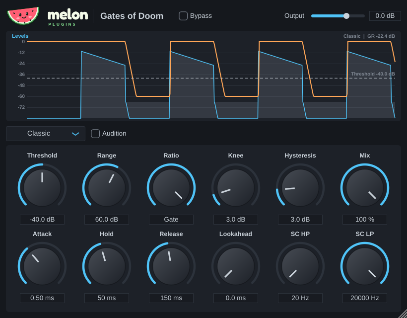

# Melon Gates of Doom — VST3 / LV2 noise gate

A precise gate / expander / ducker with the controls of a modern mixing gate (FabFilter Pro-G style). Built with [JUCE](https://juce.com).
The same code produces **VST3** (Windows, Linux and Mac), **LV2** (Linux) and a **Standalone** app.



## Controls

| Control | Range | Default | What it does |
|---|---|---|---|
| **Mode** | Classic / Clean / Guitar / Ducking | Classic | **Classic:** fast peak detection. **Clean:** smoother RMS detection and slower fades. **Guitar:** adds 4 dB of hysteresis so decaying notes don't chatter. **Ducking:** works the other way round — turns the signal *down* when it is above the threshold. |
| **Audition** | on / off | off | Listen to the filtered side-chain (to set SC HP / SC LP). |
| **Threshold** | −80 – 0 dB | −40 dB | Level where the gate opens. |
| **Range** | 0 – 100 dB | 60 dB | Maximum attenuation when closed. Lower values leave some signal through (more natural). |
| **Ratio** | 1:1 – Gate | Gate | Expansion below the threshold. Fully right = hard gate; low values = gentle downward expander. |
| **Knee** | 0 – 30 dB | 3 dB | Softens the transition around the threshold. |
| **Hysteresis** | 0 – 20 dB | 3 dB | Once open, the gate closes this many dB below the threshold. |
| **Mix** | 0 – 100 % | 100 % | Blend of gated and dry signal. |
| **Attack** | 0.01 – 100 ms | 0.5 ms | Time to open fully. |
| **Hold** | 0 – 1000 ms | 50 ms | Time the gate stays open after the signal falls under the threshold. |
| **Release** | 5 – 3000 ms | 150 ms | Time to close fully. |
| **Lookahead** | 0 – 10 ms | 0 ms | Opens the gate before the note arrives, so fast attacks are never cut. Adds this much latency (reported to the host, which compensates). |
| **SC HP** | 20 – 2000 Hz | 20 Hz (off) | Side-chain high-pass: ignore low rumble/bleed when detecting. |
| **SC LP** | 1 – 20 kHz | 20 kHz (off) | Side-chain low-pass: ignore hiss and cymbals when detecting. |

Attack and Release are the times to travel the whole Range (fades are linear in decibels, which sounds natural). Both channels share one detector (stereo-linked), so the stereo image never shifts. The header has the series' standard **Bypass** and **Output** gain.

The display is a scrolling 5-second history: **input level** (grey area), **output level** (blue), **gain reduction** (orange, from the top) and the **threshold** (dashed).

## Starting points

| Use | Threshold | Range | Attack | Hold | Release | Mode |
|---|---|---|---|---|---|---|
| High-gain guitar noise | −45 dB | 60 dB | 0.5 ms | 20 ms | 80 ms | Guitar |
| Tight metal riffs | −35 dB | 80 dB | 0.1 ms + 2 ms lookahead | 5 ms | 30 ms | Guitar |
| Tom/kick bleed | −30 dB | 25 dB | 0.2 ms + 1 ms lookahead | 60 ms | 150 ms | Classic, SC HP 80 Hz |
| Gentle vocal clean-up | −50 dB | 12 dB | 2 ms | 80 ms | 300 ms | Clean, Ratio 2:1 |

## Test

```bash
g++ -std=c++17 -O2 -ISource -I../../shared tests/test_dsp.cpp -o test_dsp && ./test_dsp
```
