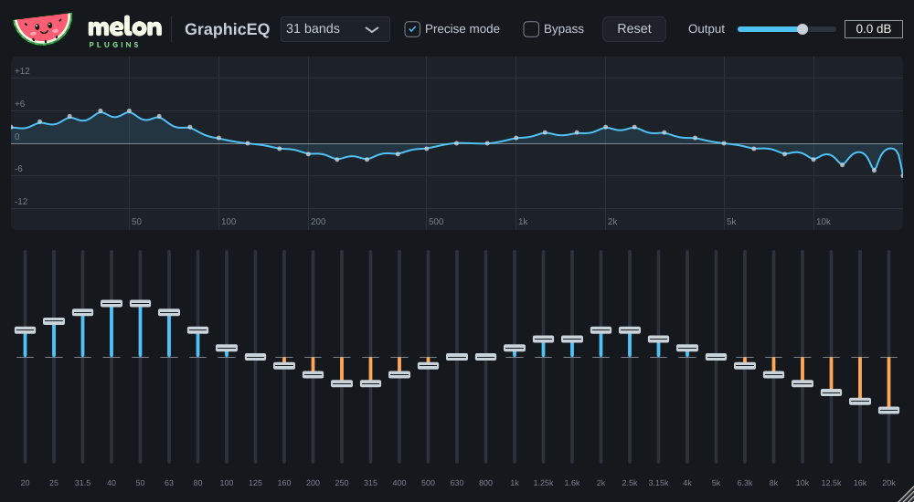

# Melon GraphicEQ — VST3 / LV2 graphic equalizer

Graphic equalizer with **10 bands** (one octave each) or **31 bands** (third-octave, ISO standard), built with [JUCE](https://juce.com).
The same code produces **VST3** (Windows, Linux and Mac), **LV2** (Linux) and a **Standalone** app.



## Features

- **10- or 31-band selector**, which can be automated. Each mode keeps its own settings, and switching does a short fade so it doesn't click.
- **±12 dB range** on every band. Double-click a slider to reset it to 0 dB.
- **Precise mode:** compensates for the interaction between neighbouring bands so the response curve passes through the slider values. Without it, a typical graphic EQ is off by 5–9 dB when several adjacent bands are raised together; with it, the error stays below 1 dB.
- **Response curve** drawn in real time.
- **Output gain** (−24 to +12 dB), **Bypass** linked to the host's bypass, and a **Reset** button.
- Parameter changes are smoothed, so there is no *zipper noise*.
- Resizable window.

## Building

This plugin is part of **Melon Plugins**. Full build instructions are in the `README.md` at the root of the series (`E:\melon_plugins`).

To build only this plugin, from the series root:

```powershell
cmake -B build -A x64
cmake --build build --config Release --target GraphicEQ_VST3
```

The plugin ends up in `build\plugins\GraphicEQ\GraphicEQ_artefacts\Release\VST3\Melon GraphicEQ.vst3`.

## Structure

| File | What it does |
|---|---|
| `Source/EqDsp.h` | Plain C++ DSP core: filters, precise mode and processing engine. |
| `Source/PluginProcessor.*` | Parameters, state and audio processing (JUCE). |
| `Source/PluginEditor.*` | User interface: sliders, response curve and controls. |
| `tests/test_dsp.cpp` | DSP test. Run it with `cmake --build build --target GraphicEQ_test_dsp`. |

## Identification

| Item | Value |
|---|---|
| Name | Melon GraphicEQ |
| Plugin code | `Geq1` |
| Manufacturer | Melon (`Meln`, defined in `cmake/MelonCommon.cmake`) |
| LV2 URI | `https://github.com/melon-audio/melon-graphiceq` |

The slider range is set by `kSliderRangeDb` in `Source/EqDsp.h`.

## JUCE license

JUCE 8 is free under the **AGPLv3** license. If you distribute the plugin, its source code must also be released under AGPLv3. The alternative is a commercial JUCE license (see the options at juce.com). There are no restrictions for personal use.
