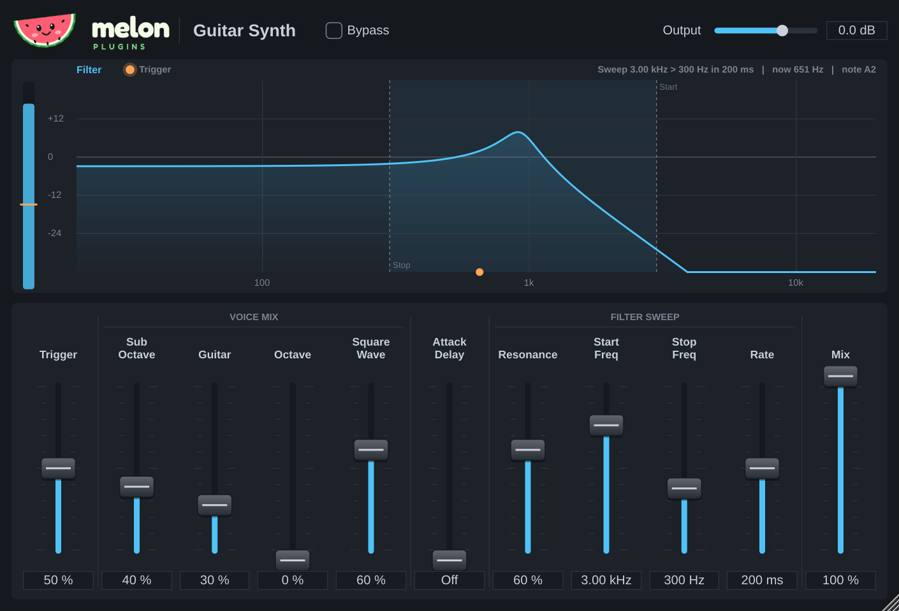

# Melon Guitar Synth — VST3 / LV2 guitar synthesizer

An analog-style guitar synthesizer with the ten controls of the classic Electro-Harmonix Micro Synthesizer pedal: **Trigger**, a four-voice mixer (**Sub Octave, Guitar, Octave, Square Wave**), **Attack Delay**, and a resonant filter that sweeps from **Start Freq** to **Stop Freq** at **Rate** on every note, plus a dry/wet **Mix**. Built with [JUCE](https://juce.com).
The same code produces **VST3** (Windows, Linux and Mac), **LV2** (Linux) and a **Standalone** app.



Demo: [`docs/melon-guitarsynth-demo.wav`](docs/melon-guitarsynth-demo.wav) — the same plucked riff four times: dry, the default synth pluck, bowed swells (Attack Delay), then a fuzz synth bass.

## Controls

The controls are faders, like the pedal's sliders, in the same order and in one row, with Mix at the end.

| Fader | Range | Default | What it does |
|---|---|---|---|
| **Trigger** | 0 – 100 % | 50 % | How loud a note must be to restart the filter sweep, from −18 dBFS (0 %, only hard picking) to −60 dBFS (100 %, the lightest touch). The orange line on the input meter shows the threshold. It only affects the filter, as on the pedal. Too sensitive and the sweep can stutter on chords; set it just sensitive enough for your playing. |
| **Sub Octave** | 0 – 100 % | 40 % | Level of a synth tone one octave below the note you play. |
| **Guitar** | 0 – 100 % | 30 % | Level of your dry guitar. |
| **Octave** | 0 – 100 % | 0 % | Level of a tone one octave above the note you play. |
| **Square Wave** | 0 – 100 % | 60 % | Level of a square wave at the note you play: the fat, buzzy synth lead. On its own it also works as a fuzz. |
| **Attack Delay** | Off – 2 s | Off | Fades every note in, removing the pick attack. Short times soften the attack; long ones give bowed or backwards-sounding swells. |
| **Resonance** | 0 – 100 % | 60 % | Sharpness of the filter peak. High settings give the vocal "wow" of a synth sweep. |
| **Start Freq** | 50 Hz – 10 kHz | 3.00 kHz | Where the filter sweep begins each time a note is triggered. |
| **Stop Freq** | 50 Hz – 10 kHz | 300 Hz | Where the sweep ends, and where the filter rests between notes. Set Start = Stop for a fixed filter (no sweep). |
| **Rate** | 4 s – 10 ms | 200 ms | Speed of the sweep. Higher = faster; the value box shows the sweep time. |
| **Mix** | 0 – 100 % | 100 % | Dry/wet balance (not on the pedal). At 100 % you hear only the synth, like the pedal: blend your guitar in with the Guitar fader, which goes through the filter. Lower it to add the untouched dry guitar back in parallel; at 0 % the plugin is fully dry. |

The synth voices (Sub Octave, Octave, Square Wave) follow your playing dynamics. Start above Stop gives the classic closing synth pluck; Start below Stop gives an opening "wah" swell.

The header has the series' standard **Bypass** (linked to the host's bypass, with a short crossfade so it doesn't click) and **Output** gain (−24 to +12 dB).
Double-click a fader to reset it. Hover over a fader for a short description. You can also type values (e.g. `1.2k`, `450 ms`).

The display shows the filter's live frequency response as it sweeps. The orange dot marks the current cutoff, the shaded band the Start → Stop range. The meter on the left is the input level, with the Trigger threshold in orange; the **Trigger** light flashes every time a note restarts the sweep. The readout shows the sweep, the current cutoff and the note being tracked.

## Using it with a guitar

- **Play single notes.** Like the pedal (and every analog guitar synth), the synth voices follow one note at a time. Chords still pass through the Guitar voice and the filter, but the synth voices will sound messy.
- **Use the neck pickup** with the tone rolled back a bit for the cleanest tracking. Put the plugin **first in the chain**, before any distortion or amp-sim; compression before it is fine.
- Notes from the low E (82 Hz) up to about the 20th fret on the high E track well.
- Works on mono or stereo tracks. The pedal is mono, so the effect works on the mono sum and sends the same signal to both sides.
- The plugin reports **one sample** of latency to the host (needed for the band-limited synth waveforms); the host compensates for it automatically.

Starting points (all with Mix at 100 %):

| Sound | Trig | Sub | Gtr | Oct | Sq | Attack | Res | Start | Stop | Rate |
|---|---|---|---|---|---|---|---|---|---|---|
| Synth pluck (default) | 50 | 40 | 30 | 0 | 60 | Off | 60 | 3.00 kHz | 300 Hz | 200 ms |
| Fuzz synth bass | 50 | 100 | 0 | 0 | 35 | Off | 75 | 1.50 kHz | 180 Hz | 100 ms |
| Bowed swells | 50 | 50 | 50 | 40 | 0 | 350 ms | 30 | 400 Hz | 2.50 kHz | 1.0 s |
| Funky auto-wah | 60 | 0 | 100 | 0 | 0 | Off | 80 | 250 Hz | 2.00 kHz | 150 ms |
| Octave lead | 40 | 0 | 20 | 70 | 50 | Off | 50 | 4.00 kHz | 1.20 kHz | 300 ms |
| Square fuzz (fixed filter) | – | 0 | 0 | 0 | 100 | Off | 20 | 2.50 kHz | 2.50 kHz | – |

## How it works

**Pitch tracking.** The input is high-passed at 60 Hz, then a steep 4-pole low-pass that follows the note (it sits on the fundamental) removes most of the harmonics. A comparator with hysteresis turns what is left into a square wave at the note's pitch. The hysteresis follows the signal level, so the guitar's harmonics can't fool it. The time between rising edges gives the pitch, which retunes the tracking filter; on each new note the filter opens up again so it can catch a jump to a higher note.

**Voices.** The square wave is the Square Wave voice. A flip-flop that toggles on every rising edge divides it by two for the Sub Octave voice (rounded off a little so it sounds like a bass tone). A full-wave rectifier on the tracked fundamental doubles its frequency for the Octave voice. The square and sub-octave edges are band-limited (polyBLEP), so high notes don't alias. The synth voices are scaled by the input envelope, and a gate fades them out below −62 dBFS so they don't chatter on hiss.

**Trigger and Attack Delay.** An envelope follower fires the trigger when the input crosses the Trigger threshold (it re-arms once the level drops to half the threshold), or when a new note is picked clearly louder than the one still ringing. The Attack Delay has its own fixed note detector (−50 dBFS), since Trigger only controls the filter on the pedal: between notes it closes, and each new note fades in over the Attack Delay time along a smooth S-curve.

**Filter.** A 3-pole resonant low-pass, like the pedal's: three one-pole stages with global feedback, solved without a unit delay (zero-delay feedback) so it stays accurate when swept fast. A soft clip (`tanh`) where the feedback is mixed back in keeps high Resonance warm and bounded, and a make-up gain gives back most of the level the feedback takes away. On every trigger the cutoff jumps to Start Freq and glides to Stop Freq on a log-frequency, RC-like curve (fast at first, settling at Stop), 95 % of the way there after the Rate time. Finally, Mix crossfades between the dry input (delayed by the same one sample, so nothing phases) and the filtered synth. Every parameter is smoothed, so moving faders never makes zipper noise.

This is not a circuit model of the Electro-Harmonix pedal. It uses the same controls and the same kind of signal path.

## Building

This plugin is part of **Melon Plugins**. Full build instructions are in the `README.md` at the root of the series (`E:\melon_plugins`).

To build only this plugin, from the series root:

```powershell
cmake -B build -A x64
cmake --build build --config Release --target GuitarSynth_VST3
```

The plugin ends up in `build\plugins\GuitarSynth\GuitarSynth_artefacts\Release\VST3\Melon Guitar Synth.vst3`.

## Structure

| File | What it does |
|---|---|
| `Source/GuitarSynthDsp.h` | Plain C++ DSP core: pitch tracker and voices, trigger and Attack Delay, swept 3-pole filter and processing engine, plus the response maths used by the display. |
| `Source/PluginProcessor.*` | Parameters, state and audio processing (JUCE). |
| `Source/PluginEditor.*` | User interface: faders, filter display, input meter and header. |
| `tests/test_dsp.cpp` | DSP test. Run it with `cmake --build build --target GuitarSynth_test_dsp`. |

The tuning constants (frequency and sweep ranges, Trigger range, maximum Resonance, gate level, voice balance) are at the top of `Source/GuitarSynthDsp.h`.

## Identification

| Item | Value |
|---|---|
| Name | Melon Guitar Synth |
| Plugin code | `Gsy1` |
| Manufacturer | Melon (`Meln`, defined in `cmake/MelonCommon.cmake`) |
| LV2 URI | `https://github.com/melon-audio/melon-guitarsynth` |

## JUCE license

JUCE 8 is free under the **AGPLv3** license. If you distribute the plugin, its source code must also be released under AGPLv3. The alternative is a commercial JUCE license (see the options at juce.com). There are no restrictions for personal use.

Electro-Harmonix and Micro Synthesizer are trademarks of their respective owner. Melon Guitar Synth is not affiliated with or endorsed by Electro-Harmonix; the pedal is named only to describe the controls.
