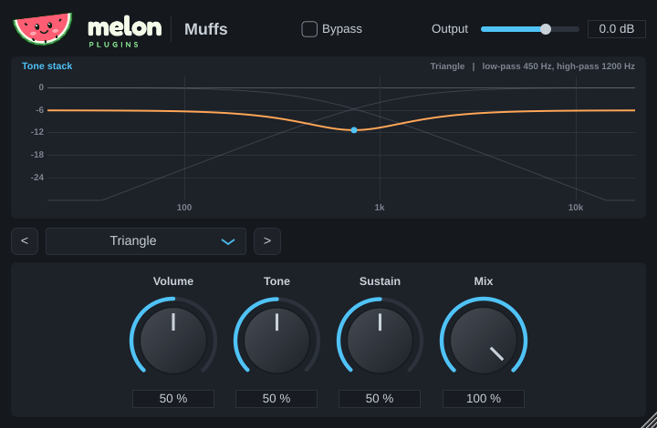

# Melon Muffs — VST3 / LV2 fuzz

Six versions of the Electro-Harmonix **Big Muff Pi** fuzz in one plugin, with the pedal's traditional **Volume, Tone, Sustain** controls plus **Mix**. Built with [JUCE](https://juce.com).
The same code produces **VST3** (Windows, Linux and Mac), **LV2** (Linux) and a **Standalone** app.



## Versions

| Version | Character |
|---|---|
| **Triangle** ('69–'73) | Smooth, full, plenty of sustain; moderate scoop |
| **Ram's Head** ('73–'77) | Less gain, more mids and a slightly brighter voice (the "Gilmour" Muff) |
| **Op-Amp** ('78) | Harder op-amp clipping, brighter and more aggressive, deep scoop |
| **Russian Civil War** (Tall Font / Green Russian) | Extra bass, darker, smooth and thick |
| **NYC** (reissue) | The classic modern Big Muff: deep scoop, big fuzz |
| **Big Muff Pi 2** | Tighter bass, more gain, more focused |

All versions are level-matched at the default settings.

## Controls

| Control | Range | Default | What it does |
|---|---|---|---|
| **Version** | 6 versions | Triangle | Drop-down, plus arrows. Switching crossfades, so it never clicks. |
| **Volume** | 0 – 100 % | 50 % | Output of the pedal. 50 % ≈ unity, 100 % = +12 dB. |
| **Tone** | 0 – 100 % | 50 % | Blends the tone stack's low-pass (bass) and high-pass (treble). At noon you get the famous mid scoop. |
| **Sustain** | 0 – 100 % | 50 % | Amount of fuzz (gain before the two clipping stages). |
| **Mix** | 0 – 100 % | 100 % | Dry/fuzz blend. Lower it to keep the attack and definition of the dry note. |

The header has the series' standard **Bypass** and **Output** gain. The display shows the **tone stack response** of the selected version at the current Tone (the bass-only and treble-only extremes are drawn faintly), with a dot at the centre of the scoop.

## How it works

Like the pedal: an input stage, **two cascaded clipping stages** (each followed by the low-pass of its feedback capacitor), the **passive tone stack** and a recovery stage. The tone stack is a first-order low-pass and a first-order high-pass blended by the Tone knob — each version has its own corner frequencies, which is the main thing that tells the versions apart. Clipping runs at **4× the sample rate** to avoid aliasing.

These are not circuit simulations: they reproduce the voicing of each version.

## Test

```bash
g++ -std=c++17 -O2 -ISource -I../../shared tests/test_dsp.cpp -o test_dsp && ./test_dsp
```
