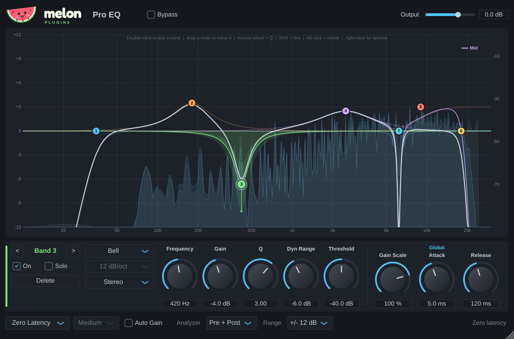

# Melon Pro EQ — VST3 / LV2 parametric equalizer

A fully featured parametric EQ for mixing and mastering (FabFilter Pro-Q style): up to 24 bands, an interactive display with a spectrum analyzer, dynamic EQ, Mid/Side and Left/Right processing, and a Linear Phase mode. Built with [JUCE](https://juce.com).
The same code produces **VST3** (Windows, Linux and Mac), **LV2** (Linux) and a **Standalone** app.

For quick tone shaping with fixed bands, use **Melon GraphicEQ** instead. Pro EQ is the precise, flexible one.



## Working in the display

| Action | What it does |
|---|---|
| **Double-click** an empty spot | Adds a band there (a Bell; a Low Cut below 30 Hz, a High Cut above 15 kHz) |
| **Right-click** an empty spot | Adds a band of the type you choose |
| **Drag** a node | Frequency (left/right) and gain (up/down). On cuts, notch and band pass, up/down changes Q |
| **Shift** + drag | Fine adjustment |
| **Mouse wheel** over a node | Q (bandwidth) |
| **Double-click** a node | Switches the band on/off |
| **Alt-click** (or middle-click) a node | Deletes the band |
| **Right-click** a node | Menu: type, slope, stereo placement, enable, solo, make dynamic, delete |

The panel under the display edits the selected band; **< >** step through the bands in use.
The thick white line is the total curve for bands set to *Stereo*. Bands set to Left, Right, Mid or Side add an extra curve each (listed at the top-right), showing what that part of the signal gets.

## Band controls

| Control | Range | What it does |
|---|---|---|
| **Type** | Bell, Low Shelf, Low Cut, High Shelf, High Cut, Notch, Band Pass, Tilt Shelf | Filter shape. *Tilt Shelf* turns the lows down and the highs up by half the gain each (or the opposite), pivoting on the frequency. |
| **Slope** | 6 – 96 dB/oct | Steepness of cuts and band pass (6, 12, 18, 24, 30, 36, 48, 72, 96). Shelves and tilt: 6 dB/oct (gentle, first order) or 12 dB/oct (any higher setting). |
| **Stereo** | Stereo, Left, Right, Mid, Side | Which part of the signal the band works on. |
| **Frequency** | 10 Hz – 30 kHz | Centre or corner frequency. |
| **Gain** | ±30 dB | Boost or cut (Bell, shelves, tilt). |
| **Q** | 0.025 – 40 | Bandwidth. On cuts it is the resonance at the corner: 0.71 is flat (Butterworth), higher adds a bump. |
| **Dyn Range** | ±30 dB | Dynamic EQ. 0 = a normal static band. Negative: the band cuts further when the input around its frequency is loud (like a compressor on that band, e.g. taming harsh "s" sounds or a boomy note). Positive: it boosts when loud. |
| **Threshold** | −80 – 0 dB | Dynamic EQ: level where the band starts to move. Above it the gain moves 0.75 dB per dB, up to Dyn Range. |
| **On / Solo / Delete** | | Solo lets you hear only the region the band works on (a listening aid, not saved). |

The display shows dynamic bands with a shaded area (the range they can move over) and the node follows the live gain.

## Global controls

| Control | What it does |
|---|---|
| **Gain Scale** (−100 – 200 %) | Scales the gain of every band at once. 0 % = flat, −100 % = every boost becomes a cut. |
| **Attack / Release** | How fast dynamic bands react and recover. |
| **Zero Latency / Linear Phase** | *Zero Latency*: minimum-phase filters, like an analog EQ, no delay. *Linear Phase*: no phase shift at all (useful in mastering and when EQ-ing one of several mics), at the cost of latency. The host compensates the latency automatically. |
| **Resolution** (Linear Phase) | Low / Medium / High: about 43 / 85 / 171 ms of latency (at 48 kHz). Higher = more precise low frequencies (steep low cuts, narrow bass bells). |
| **Auto Gain** | Keeps the loudness about the same while you boost or cut (based on the average change of the gain bands between 40 Hz and 16 kHz). |
| **Analyzer** | Spectrum of the input (*Pre*, grey), output (*Post*, blue) or both. Tilted +4.5 dB/oct so a typical mix looks roughly flat. Scale on the right side. |
| **Range** | Vertical zoom of the EQ curve: ±30, ±12, ±6 or ±3 dB. |
| **Bypass / Output** | The series' standard header controls. |

## How it works

- **Zero Latency:** each band is a cascade of biquads (Audio EQ Cookbook / Butterworth designs, double precision). Parameter changes are smoothed every 32 samples, and changing a band's type, slope or placement fades it out and back in, so nothing clicks. Bands set to Mid/Side are processed after the Stereo/Left/Right ones.
- **Linear Phase:** the same magnitude curve is turned into one FIR filter (a 2×2 matrix when Mid/Side bands are used) and applied with FFT convolution. The filter is redesigned on a background thread whenever you change a setting and crossfaded in, so the audio thread never waits. Kernel size grows with the sample rate (×2 at 88.2/96 kHz), so the latency in milliseconds stays the same. In this mode the *dynamic* part of dynamic bands runs as a minimum-phase filter after the FIR.
- **Dynamic EQ** listens to the input (before the EQ) through a filter around the band (band pass for Bell and Tilt, low-pass for Low Shelf, high-pass for High Shelf).

## Test

```bash
g++ -std=c++17 -O2 -ISource -I../../shared tests/test_dsp.cpp -o test_dsp -pthread && ./test_dsp
```

It checks every filter shape and slope, stereo placement, Gain Scale, dynamic EQ, Linear Phase (same gain as Zero Latency, symmetric impulse response, correct latency), Auto Gain, Solo, Bypass, random automation in both modes, and the background kernel designer.
