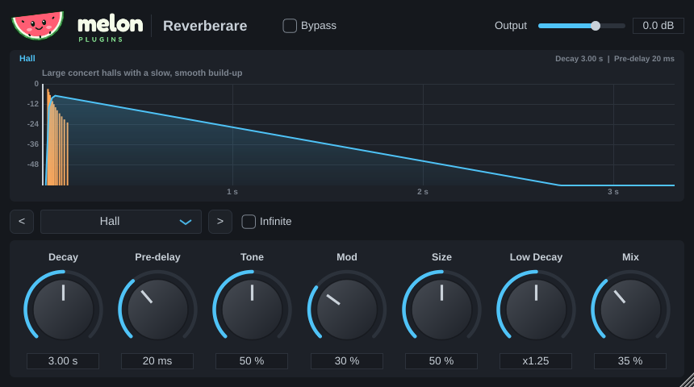

# Melon Reverberare — VST3 / LV2 reverb

A stereo multi-machine reverb in the spirit of the **Strymon BigSky**: twelve reverb machines sharing the same knobs, plus two machine-specific parameters and **Infinite** (freeze). Built with [JUCE](https://juce.com).
The same code produces **VST3** (Windows, Linux and Mac), **LV2** (Linux) and a **Standalone** app.



## Machines

| Machine | Param 1 | Param 2 | Sound |
|---|---|---|---|
| **Room** | Size | Early/Late | Small to medium rooms; Param 2 balances early reflections and tail |
| **Hall** | Size | Low Decay | Large concert halls with a slow, smooth build-up |
| **Plate** | Size | Low Decay | Bright, dense studio plate (no early reflections) |
| **Spring** | Dwell | Drip | Amp-style spring tank: Dwell drives the springs, Drip sets the "boing" (dispersion) |
| **Swell** | Rise | Low Decay | Every new note fades in (volume swell) into a lush reverb |
| **Bloom** | Length | Feedback | The reverb grows after the note — a slow, blooming build-up |
| **Cloud** | Diffusion | Low Decay | Huge, smeared ambient wash with no clear attack |
| **Chorale** | Vowel | Formant | Tail shaped by vocal formants (oo, oh, ah, eh, ee): choir-like |
| **Shimmer** | Interval | Shimmer | Pitch-shifted voices (octave down, fifth, octave, octave + fifth, two octaves) regenerate in the tail |
| **Magneto** | Echo Time | Repeats | Three-head tape echo (with wow) feeding a reverb |
| **Nonlinear** | Shape | Diffusion | Reverse (0 %), gated (50 %) and decaying (100 %) effects; Decay sets the length |
| **Reflections** | Room Size | Diffusion | Early reflections only: the sound of a room's walls |

"Low Decay" multiplies the decay time of the bass (below ~250 Hz) from ×0.5 to ×2.

## Controls

| Control | Range | Default | What it does |
|---|---|---|---|
| **Machine** | 12 machines | Hall | Drop-down, plus arrows. Switching fades out and back in. |
| **Infinite** | on / off | off | Freezes the current tail and holds it forever; new notes play dry over it. |
| **Decay** | 0.1 – 60 s | 3 s | Reverb time (RT60): the time for the tail to fall by 60 dB. |
| **Pre-delay** | 0 – 500 ms | 20 ms | Gap between the dry note and the reverb. |
| **Tone** | 0 – 100 % | 50 % | Dark to bright tail (high-frequency damping from 1.5 kHz to 18 kHz). |
| **Mod** | 0 – 100 % | 30 % | Slow modulation of the tail: static to lush and chorused. |
| **Param 1 / 2** | 0 – 100 % | 50 % | Depend on the machine (the labels and values change with it). |
| **Mix** | 0 – 100 % | 35 % | Dry/wet balance (equal-power). |

The header has the series' standard **Bypass** and **Output** gain. The display shows the selected machine with a sketch of its envelope: the dry note, pre-delay, early reflections (orange) and the tail falling over the Decay time.

## How it works

The core is an **8-line feedback delay network** with a Hadamard mixing matrix, preceded by input diffusers and pre-delay. Each line's feedback gain is computed from its length and the Decay time, so the RT60 is the same whatever the room size; a two-band split gives the separate bass decay, and a one-pole low-pass per line sets the damping (Tone). The line lengths are slowly modulated (Mod) to avoid metallic ringing. The machines add their own blocks around this core: early-reflection taps, long diffusers (Bloom with feedback, Cloud with six stages), a volume-swell envelope, a three-head tape echo, a dispersive allpass chain (Spring), vowel formant filters (Chorale), a pitch shifter inside the feedback loop (Shimmer) and a shaped tap window (Nonlinear). Infinite sets the network's feedback to exactly 1 with no damping and stops feeding new sound in.

This is not a copy of the BigSky's algorithms: it follows the same idea and controls.

## Test

```bash
g++ -std=c++17 -O2 -ISource -I../../shared tests/test_dsp.cpp -o test_dsp && ./test_dsp
```
